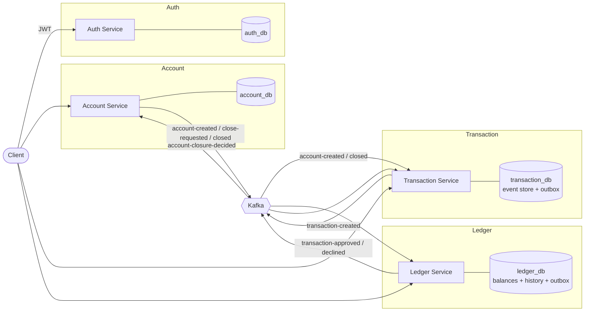
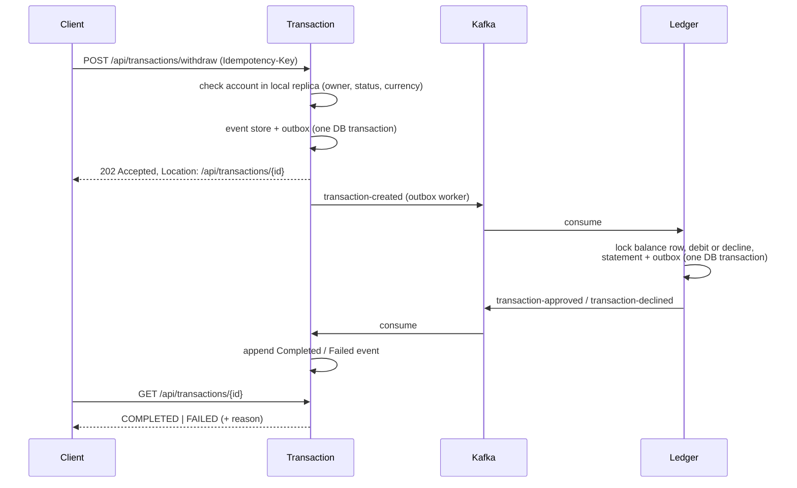
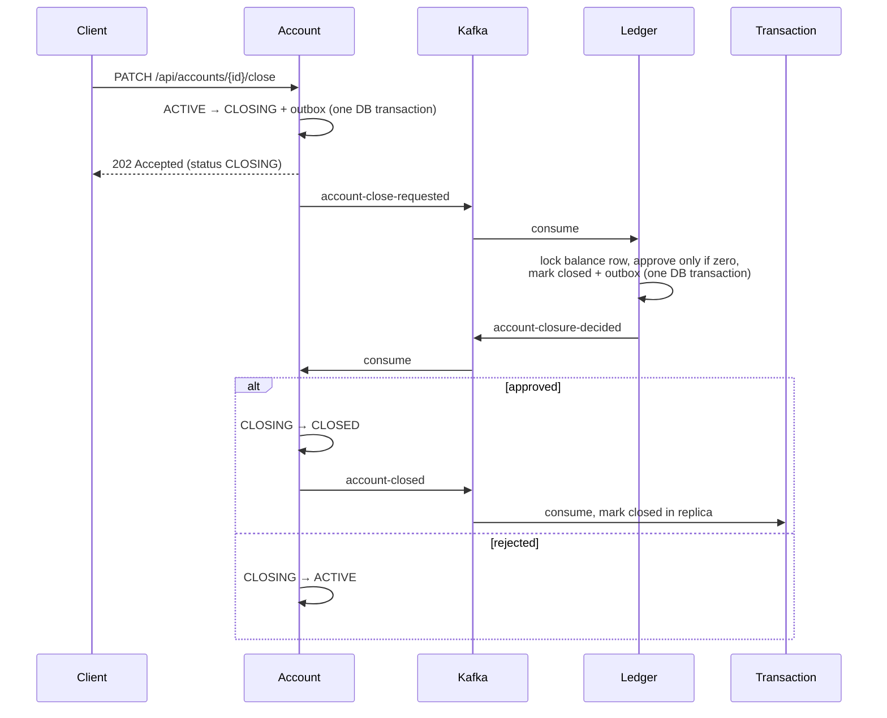
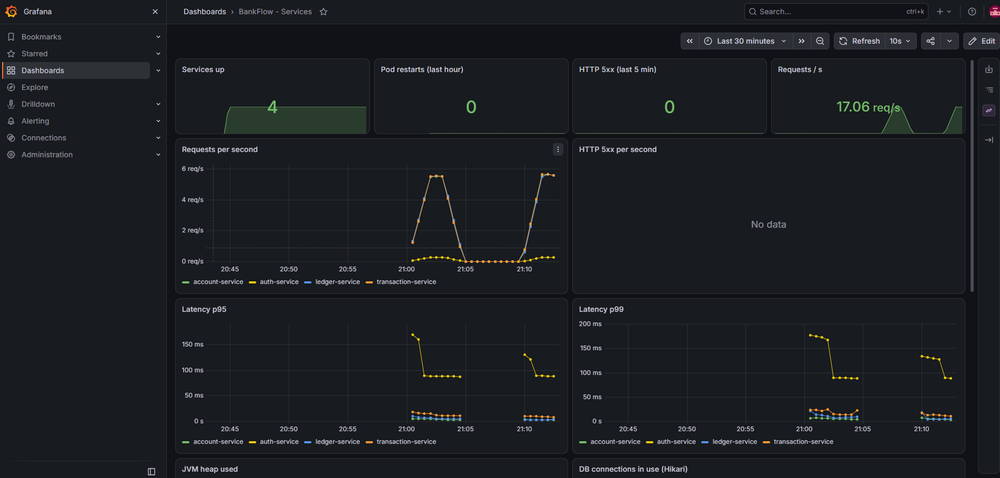

# BankFlow

[](https://github.com/nikola8217/Bankflow/actions/workflows/ci.yml)

A distributed banking backend demonstrating event sourcing, a choreography saga over Kafka and the transactional outbox, designed to stay correct under concurrency and partial failure. Its consistency guarantees are verified by automated tests running against real PostgreSQL and Kafka (Testcontainers). It runs on Kubernetes with Helm, with metrics, dashboards and centralized structured logs.

**Tech stack:** Java 21 · Spring Boot 4 · Apache Kafka (KRaft) · PostgreSQL · Kubernetes · Helm · Strimzi · Envoy Gateway · Prometheus · Grafana · Loki · Testcontainers · GitHub Actions · Trivy

---

## Architecture



| Service | Owns | Responsibility |
|---|---|---|
| **Auth** | users | Registration, login, JWT issuing |
| **Account** | accounts | Opens accounts and runs the account-closing saga; publishes `account-created` and `account-closed` |
| **Transaction** | transaction lifecycle (event-sourced) | Accepts deposits, withdrawals and transfers; tracks each one to `COMPLETED` or `FAILED` |
| **Ledger** | balances (system of record) | Books money under row locks, decides approve/decline, keeps the account statement |

Each service has its own database; services never read each other's tables.

### Transaction flow

1. The client sends a deposit, withdrawal or transfer to the Transaction service, optionally with an `Idempotency-Key`.
2. The Transaction service checks in its local copy of accounts (built from `account-created` events) that the source account exists, is active and belongs to the user. No other service is called.
3. In one database transaction it appends `TransactionInitiated` to the event store and writes `TransactionCreated` to the outbox.
4. The client immediately receives **202 Accepted** with `Location: /api/transactions/{id}`.
5. The outbox worker publishes the event to Kafka (`transaction-created`).
6. The Ledger locks the balance row(s), books the money or declines, and in the same database transaction writes the statement entry and a `TransactionApproved` or `TransactionDeclined` event to its outbox.
7. The Transaction service consumes the result and appends `TransactionCompleted` or `TransactionFailed`.
8. The client polls `GET /api/transactions/{id}` and sees `COMPLETED` or `FAILED` with a reason.



Deposits follow the same path: they stay `PENDING` until the Ledger has booked them.

### Account closing

Closing is a saga between Account and Ledger, because only the Ledger knows whether the account still holds money.

1. The client calls `PATCH /api/accounts/{id}/close`. Account moves the account to `CLOSING`, writes `account-close-requested` to its outbox and returns **202 Accepted**.
2. The Ledger locks the balance row and decides: it approves only if the balance is zero, and from then on refuses every booking on that account. It answers with `account-closure-decided`.
3. Approved: Account moves the account to `CLOSED` and publishes `account-closed`. Rejected: Account moves it back to `ACTIVE` (the compensating step).
4. The Transaction service marks the account closed in its replica, so new transactions on it are rejected at the API instead of failing later in the Ledger.



The client sees the outcome with `GET /api/accounts/{id}`.

---

## Patterns

**Event sourcing (Transaction).** A transaction's state is never stored directly; it is rebuilt from its events (`Initiated → Completed | Failed`). The status endpoint is served by replaying the aggregate from the event store.

**Ledger as the system of record for balances.** The Ledger is the single writer of balances. It enforces "no overdraft" under a pessimistic lock and is the service that approves or declines.

**CQRS.** Commands and queries take separate paths. Read models: the transaction status (from the event store) and the account statement (a projection in the Ledger).

**CommandBus.** Every write in the Transaction service is a command object dispatched through a small, hand-written `CommandBus` to exactly one handler, discovered through Spring's dependency injection. Controllers stay thin, and adding a new operation means adding a command and a handler without touching existing code.

**Choreography sagas.** Two flows span services: a transaction (Transaction ↔ Ledger) and closing an account (Account ↔ Ledger, with a compensating step back to `ACTIVE`). The services coordinate only through events; there is no orchestrator. With two participants per flow, an orchestrator would add coupling without adding value.

**Transactional outbox (all three producers).** Domain changes and the outgoing event are committed in the same database transaction; a worker publishes to Kafka and marks the row only after the broker acknowledges it.

**Hexagonal architecture.** Business logic depends on ports (`EventStore`, `AccountDirectory`, `TransactionRunner`, …); Spring, JPA, Kafka and HTTP live in adapters (persistence, messaging, web). This keeps most business tests plain unit tests.

---

## Consistency guarantees

| Guarantee | How |
|---|---|
| A balance never goes below zero, even under concurrent withdrawals | Balance rows are locked with `SELECT … FOR UPDATE`; transfers lock both accounts in a fixed order to prevent deadlocks |
| A redelivered Kafka message is booked only once | Idempotent consumers: the processed-event key is stored in the same DB transaction as the booking |
| No event is lost between the database and Kafka | Transactional outbox; a row is marked as published only after the broker acknowledges it |
| Events for one account reach Kafka in the order they were written, even with several replicas | Every replica runs the outbox relay, but a transaction-scoped advisory lock lets only one publish at a time; it sends rows oldest first and stops at the first failure. The others are hot standbys |
| A malformed message cannot block a consumer | `ErrorHandlingDeserializer`, retries with back-off, then a dead-letter topic (`<topic>-dlt`) |
| A retried HTTP request never moves money twice | `Idempotency-Key` scoped per user: a retry returns the original transaction, a reused key with a different payload is rejected (422), concurrent duplicates all receive the same result |
| A transaction can be accepted while the Account service is down | No service calls another over HTTP; Transaction validates accounts against its own replica, filled from `account-created` events |
| An account is closed only with a zero balance, and no money moves on it afterwards | The Ledger decides the closure under the same row lock it books with, so a closure and a concurrent booking cannot both win; once closed, the Ledger declines every booking and the Transaction service rejects new requests from its replica |
| Amounts are exact to the cent | Amounts with more than two decimal places are rejected at the API boundary |
| Errors are reported accurately | Client errors map to 4xx; unexpected errors return a generic 500 and are logged with a full stack trace |

## Security

- **Ownership checks everywhere.** A user can only read or use their own accounts, balances, statements and transactions; someone else's resource returns **404**, so its existence is not revealed.
- **No service-to-service HTTP.** Services share data only through Kafka events, so there is no internal endpoint or shared API key to protect.
- **JWT (HS256)** with no default secret: a service refuses to start if the secret is missing or too short.

---

## API

| Method | Endpoint | Description |
|---|---|---|
| POST | `/api/auth/register` | Register a user |
| POST | `/api/auth/login` | Obtain a JWT |
| POST | `/api/accounts` | Open an account |
| GET | `/api/accounts/user` | My accounts |
| GET | `/api/accounts/{id}` | Account details |
| PATCH | `/api/accounts/{id}/close` | Start closing an account → 202 (`CLOSING`) |
| POST | `/api/transactions/deposit` | Deposit → 202 |
| POST | `/api/transactions/withdraw` | Withdraw → 202 |
| POST | `/api/transactions/transfer` | Transfer → 202 |
| GET | `/api/transactions/{id}` | Transaction status and failure reason |
| GET | `/api/ledger/balance/{accountId}` | Current balance |
| GET | `/api/ledger/history/{accountId}` | Account statement (incoming transfers included) |

Write endpoints accept an optional `Idempotency-Key` header.

### Kafka topics

| Topic | Producer | Consumer |
|---|---|---|
| `account-created` | account-service | ledger-service, transaction-service |
| `account-close-requested` | account-service | ledger-service |
| `account-closure-decided` | ledger-service | account-service |
| `account-closed` | account-service | transaction-service |
| `transaction-created` | transaction-service | ledger-service |
| `transaction-approved` | ledger-service | transaction-service |
| `transaction-declined` | ledger-service | transaction-service |

Messages are keyed by account ID, so events for one account are processed in order. Topics are created explicitly (3 partitions, plus a `<topic>-dlt` dead-letter topic each); broker auto-creation is disabled.

---

## Testing

Unit tests cover the domain and command handlers; integration tests use **Testcontainers** (real PostgreSQL 16 and Kafka) for everything that depends on locking, SQL or the broker. CI (GitHub Actions) runs the full suite for every service on each pull request; `main` accepts changes only through pull requests.

```bash
cd api
./mvnw test                                   # all services
./mvnw test -pl ledger-service -am            # one service (+ shared)
```

Docker must be running for the integration tests.

---

## CI/CD

Every pull request and every push to `main` runs the GitHub Actions pipeline:

1. **Test** - the full suite for each service runs in parallel (matrix job).
2. **Build** - a Docker image per service.
3. **Scan** - Trivy reports HIGH and CRITICAL vulnerabilities in each image; any CRITICAL one fails the build.
4. **Publish** (`main` only) - images are pushed to GitHub Container Registry as `ghcr.io/nikola8217/bankflow-<service>:<commit-sha>` and `:latest`.

Third-party actions with a history of compromise are pinned to a commit SHA. `main` is protected and accepts changes only through pull requests.

---

## Running on Kubernetes

The same system runs on a local Kubernetes cluster (Docker Desktop), deployed with Helm:

- **PostgreSQL** - one instance per service (StatefulSet with a persistent volume).
- **Kafka** - managed by the **Strimzi** operator, in KRaft mode.
- **Services** - one reusable Helm chart for all four: startup, liveness and readiness probes; configuration in a ConfigMap (a change triggers a rolling restart); secrets read from a Kubernetes Secret, never committed.
- **Gateway** - **Envoy Gateway** (Gateway API) exposes `/api/**` on `http://localhost`; `/actuator` is not routed, so it stays reachable only inside the cluster.

Step-by-step instructions: [deploy/README.md](deploy/README.md).

---

## Observability

- **Metrics.** Every service exposes Prometheus metrics; Prometheus (kube-prometheus-stack) discovers them through a `ServiceMonitor`. HTTP latency histograms give p95 and p99 per service.
- **Dashboard as code.** The Grafana dashboard is provisioned from [deploy/monitoring/bankflow-dashboard.yaml](deploy/monitoring/bankflow-dashboard.yaml): services up, pod restarts, request rate, 5xx errors, p95/p99 latency, JVM heap, database connections in use and recent error logs.
- **Structured logs.** Services log JSON; Grafana Alloy collects pod logs into **Loki**, labelled by service and level, so all errors across the system are one query away: `{namespace="bankflow", level="ERROR"}`.



---

## Running locally

**Prerequisites:** Docker and Docker Compose.

```bash
git clone https://github.com/nikola8217/Bankflow.git
cd Bankflow
cp .env.example .env          # then set JWT_SECRET
docker compose up -d --build
```

| Service | Swagger UI |
|---|---|
| Auth | http://localhost:8081/swagger-ui.html |
| Account | http://localhost:8082/swagger-ui.html |
| Transaction | http://localhost:8083/swagger-ui.html |
| Ledger | http://localhost:8084/swagger-ui.html |

Kafdrop (Kafka UI): http://localhost:9000.

To run on Kubernetes instead, see [Running on Kubernetes](#running-on-kubernetes).

In Swagger, click **Authorize** and paste the token from `POST /api/auth/login`.

To run a single service from the IDE, keep the rest in Docker and set `JWT_SECRET` as an environment variable in the run configuration. The defaults point to the databases and to Kafka on `localhost:9094`.

---

## Design decisions & trade-offs

**Event sourcing only for transactions.** Transactions have a lifecycle and need an audit trail; accounts and users are simple CRUD, where event sourcing would be over-engineering.

**The Ledger owns balances.** Keeping every balance change in one service lets correctness rely on local database transactions and row locks instead of distributed coordination.

**At-least-once delivery plus idempotent consumers,** rather than exactly-once. The outbox may publish an event twice after a crash, and every consumer tolerates duplicates. This is simpler and more robust than Kafka transactions spanning the database.

**One active outbox relay per service.** Relays on several replicas publishing different batches in parallel would be faster, but could send an account's newer event before an older one, and the Ledger would then see a withdrawal before the deposit that funds it. So only the replica holding an advisory lock publishes. The cost is throughput bounded by one relay; if that ever becomes the limit, the next step is claiming rows per message key (or per partition) instead of globally.

**Local account replica instead of a synchronous lookup.** The Transaction service keeps its own copy of accounts (id, owner, currency, status), filled from `account-created` events, instead of asking the Account service on every request. It no longer depends on Account being up, and a request makes no network call before it is accepted. The price is eventual consistency: for a second or two after an account is opened, its first transaction gets a 404 and the client retries. Closures reach it through `account-closed`. Because `account-created` and `account-closed` are different topics with no ordering between them, a closure is written as an upsert and a late creation never overwrites an existing row, so a closed account cannot come back as active. A new consumer group reads the topic from the beginning, which fills the replica as long as Kafka still retains the events; a production system would backfill it once from the Account database.

**Closing an account as a saga.** Account cannot know whether an account still holds money, and asking the Ledger over HTTP would bring back the synchronous coupling the replica removed. So closing is asynchronous: the account waits in `CLOSING` until the Ledger decides, and the client gets 202 instead of an immediate answer. The cost is a short window in which the account is neither open nor closed; deposits accepted in that window either land before the Ledger's decision (and the closure is rejected) or are declined after it.

**One statement row per transaction.** A transfer appears in both parties' statements from a single row. Double-entry bookkeeping (a debit and a credit posting per transfer) is on the roadmap.